# UML баримт (автоматаар үүсгэсэн: `python3 -m constitution.uml`)

## 1. Бүрэлдэхүүн / өгөгдлийн урсгал
```mermaid
flowchart LR
    TXT[(undsen_khuuli_mn.txt<br/>legalinfo lawId=367)] --> P[text_mn.py<br/>parse / modality / delegations]
    P --> Q{{q&#40;pid, phrase&#41;<br/>verbatim guard}}
    A[articles.py<br/>71 articles, TOTAL_SEATS=126] --> C
    M[model.py] -.types.-> A
    PR[procedures.py<br/>8 state machines] --> C[checks.py<br/>rules]
    PR --> S[stress.py<br/>7 scenarios]
    Q --> C
    C --> R[report.py]
    S --> R
    R --> J[out/report.json]
    R --> MD[out/REPORT.md]
    J --> E[explorer/build.py] --> H[out/explorer.html]
    PR --> U[uml.py] --> UM[docs/UML.md + out/uml.html]
```

## 2. Ангийн диаграм (model.py, procedures.py)
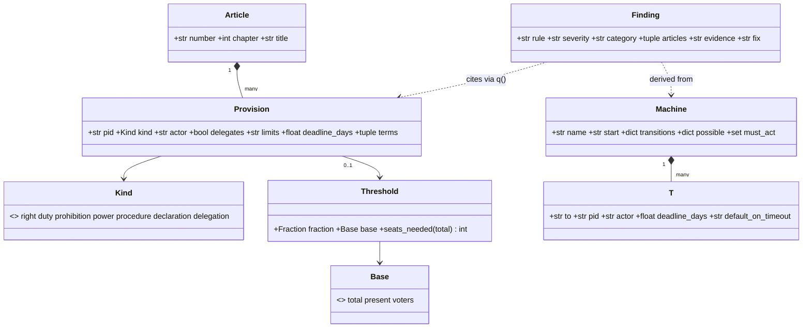

## 3. Тохиолдол: 2025 оны 10-р сар (дараалал)
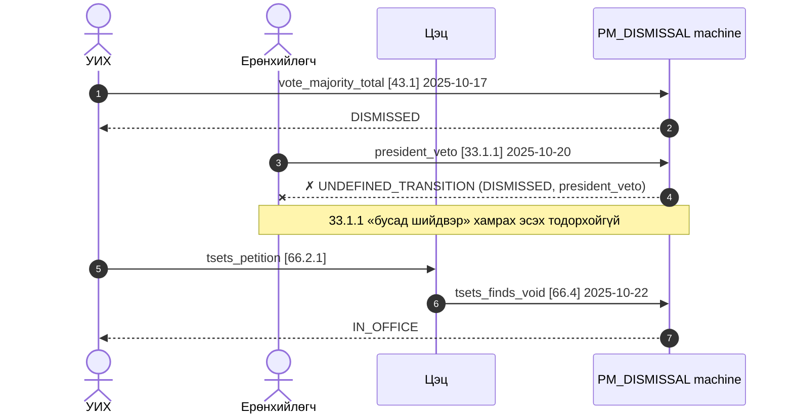

Төлөвт машин бүрийг хоёр давхаргаар: (а) зөвхөн Үндсэн хууль, (б) Үндсэн хууль + хууль. ⚖ — зөвхөн энгийн хуулиар тодорхойлогдсон шилжилт/хугацаа; цэнхэр төлөв — зөвхөн хуульд байдаг; улаан — аль ч давхаргад заагаагүй.

## 4. Төлөвт машин: Ерөнхий сайдыг огцруулах (43, 33.1.1, 22.3, 66)
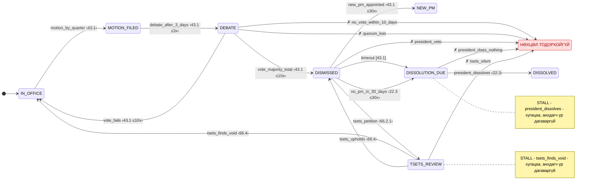

## 4б. Ерөнхий сайдыг огцруулах (43, 33.1.1, 22.3, 66) + хууль
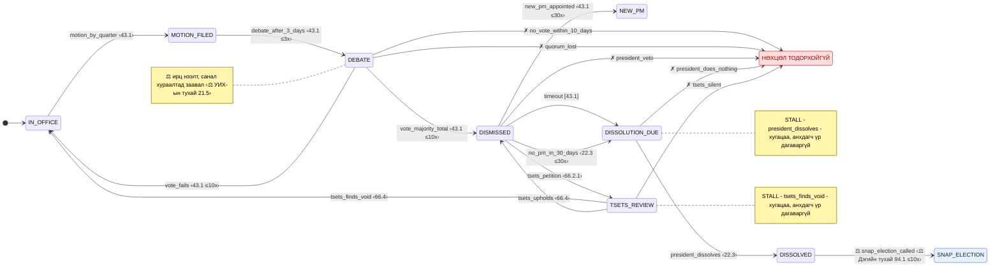

## 5. Төлөвт машин: Итгэл хүлээлгэх (44)
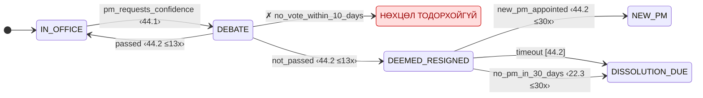

## 6. Төлөвт машин: Засгийн газар бүрдүүлэх (39.2, 22.3)
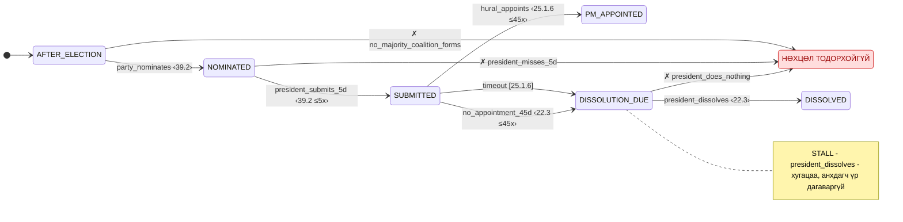

## 6б. Засгийн газар бүрдүүлэх (39.2, 22.3) + хууль
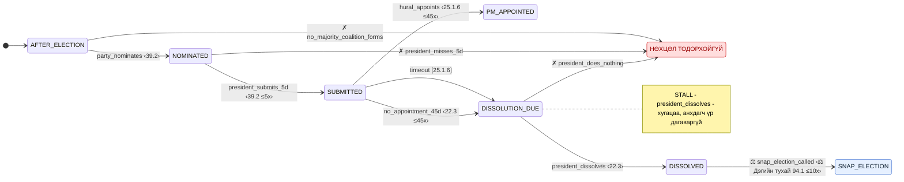

## 7. Төлөвт машин: Ерөнхийлөгчийн хориг (33.1.1)
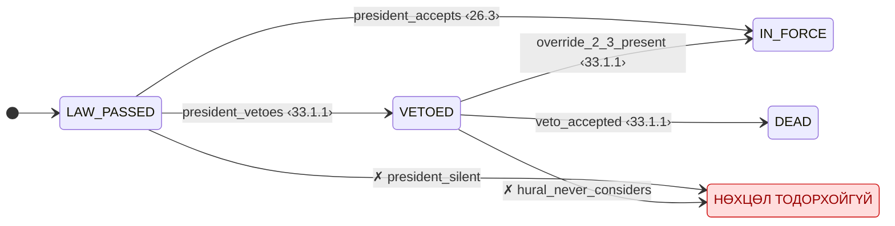

## 7б. Ерөнхийлөгчийн хориг (33.1.1) + хууль
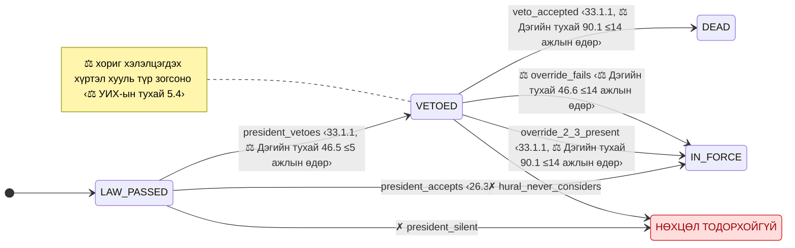

## 8. Төлөвт машин: Онц/дайны байдал (25.1.18, 33.1.12, 19.2)
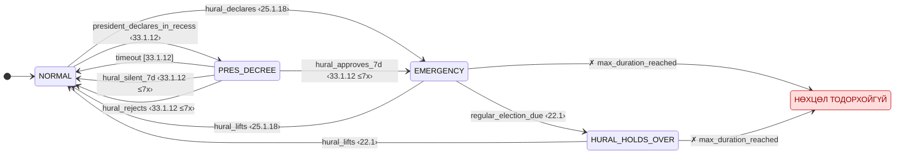

## 8б. Онц/дайны байдал (25.1.18, 33.1.12, 19.2) + хууль
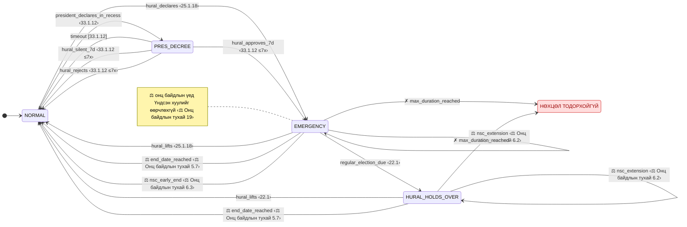

## 9. Төлөвт машин: Цэцийн хяналт (66)
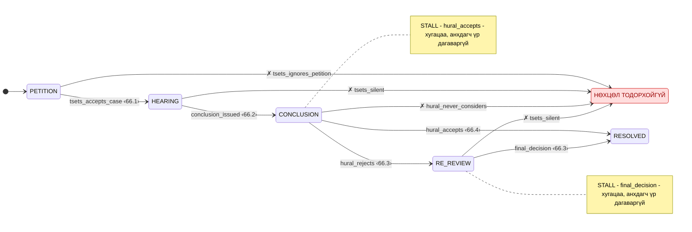

## 9б. Цэцийн хяналт (66) + хууль
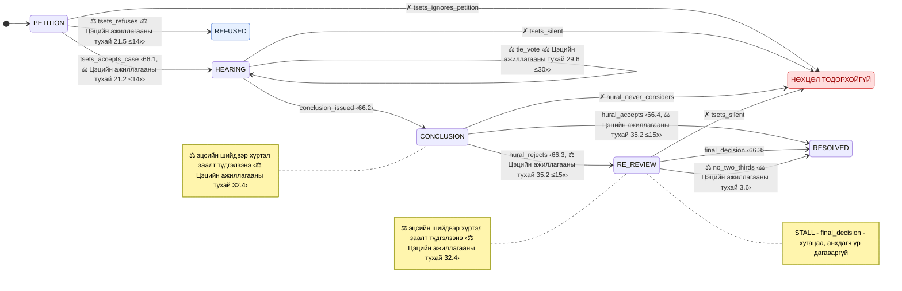

## 10. Төлөвт машин: Ерөнхийлөгчийн сонгууль (31, 32.1, 30.2)
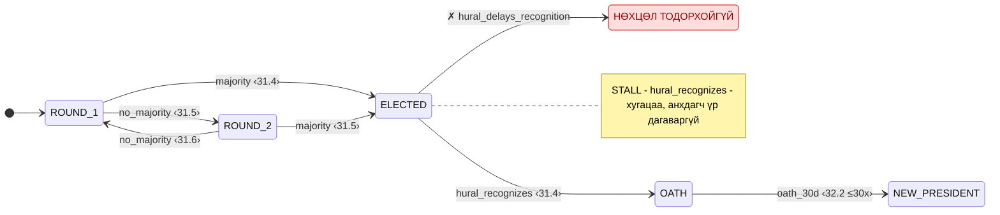

## 11. Төлөвт машин: Үндсэн хуульд нэмэлт өөрчлөлт (68, 69)
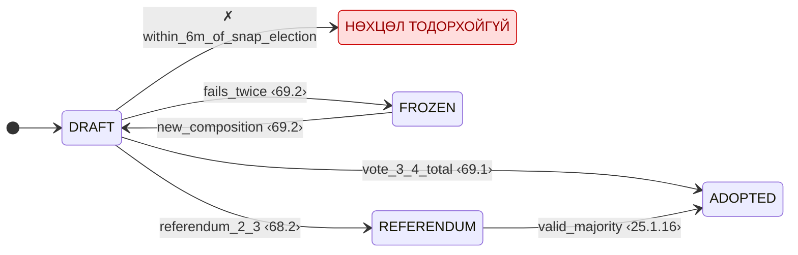
